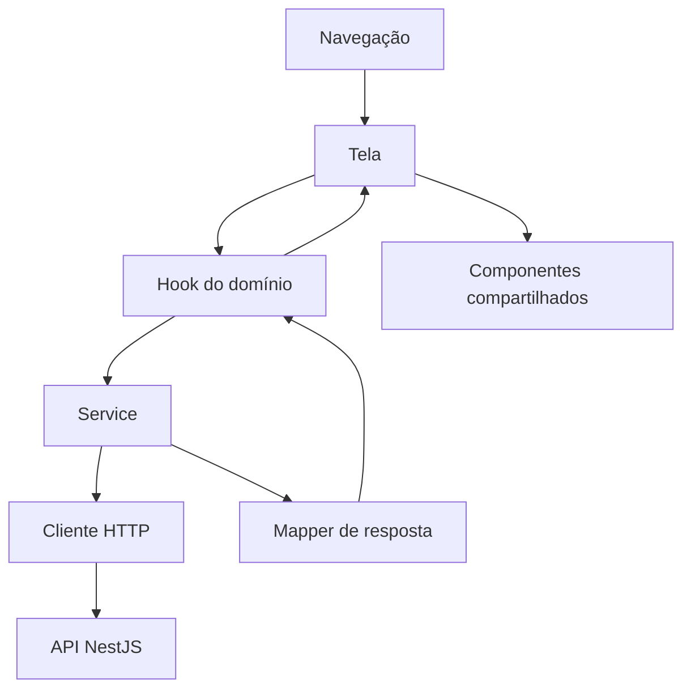

# Arquitetura do aplicativo

Este documento descreve a organização atual do HortiVia mobile e indica onde implementar mudanças sem duplicar responsabilidades. O app usa React Native CLI; `src/features` organiza as regras por domínio e `src/screens` compõe os fluxos de navegação.

## Fluxo de dados

As telas coordenam a apresentação e a navegação. Hooks de domínio controlam carregamento, mutações e estado assíncrono. Services fazem I/O, e mappers convertem respostas externas para os tipos usados pela interface.

## Onde encontrar cada responsabilidade

- `src/app`: composição raiz e providers globais.
- `src/navigation`: stacks, tabs e proteção/transição entre áreas autenticadas.
- `src/types/navigation.ts`: parâmetros tipados das rotas.
- `src/screens`: telas de fluxo e composição de componentes. Regras que possam ser reutilizadas ou testadas fora da tela pertencem ao domínio correspondente.
- `src/features/<domínio>`: comportamento por domínio:
  - `auth`: sessão, credenciais e recuperação de acesso.
  - `products`: catálogo, favoritos, histórico, guias e imagens.
  - `articles`: leitura, comentários, reações e artigos salvos.
  - `training`: perguntas, respostas, progresso e ranking.
  - `profile`: perfil próprio e público, avatar e dados de apresentação.
  - `admin`: formulários e operações administrativas de conteúdo.
  - `preferences`: preferências persistidas do usuário.
- `src/components`: controles compartilhados entre domínios. Um componente deve encapsular uma apresentação ou interação realmente reutilizada, sem absorver regras de negócio do domínio.
- `src/services/api`: Axios, autenticação HTTP, erros, endpoints, uploads e transporte comum.
- `src/config`: valores de ambiente e configuração central. Telas não devem definir URLs de API.
- `src/contexts` e `src/hooks`: estado/contextos transversais, como autenticação e tema. Estado específico de um domínio permanece em `features/<domínio>`.
- `src/theme`: tokens visuais e temas.
- `src/types`: tipos realmente compartilhados entre domínios; tipos de resposta e de operações pertencem ao domínio que os usa.
- `src/utils`: funções puras transversais. Regras de produto não devem ser movidas para utilitários genéricos.

## Caminho recomendado para uma mudança

1. Atualize ou crie o tipo do domínio.
2. Mantenha endpoints e detalhes HTTP em `src/services/api` e a operação de domínio em `features/<domínio>/services`.
3. Normalize formatos externos em um mapper; não espalhe leitura tolerante de payload entre componentes.
4. Use um hook do domínio para coordenar carregamento, concorrência, erros e mutações reutilizadas.
5. Deixe a tela compor estados visuais e navegação. Extraia um componente quando houver reutilização ou uma unidade visual com responsabilidade própria.
6. Coloque o teste junto ao módulo alterado e preserve testes de fluxo quando a mudança atravessar navegação, autenticação ou API.

## Convenções importantes

- Cada tela ou componente React Native vive em sua pasta; estilos usam `styled-components/native` em `styles.ts`.
- Os componentes são funções TypeScript, sem `React.FC`.
- A API é centralizada em `src/config/apiConfig.ts` e `src/services/api`.
- Chaves de cache e estado assíncrono devem ter um único proprietário. Não mantenha em estado algo que possa ser derivado com segurança dos dados atuais.
- Proteções contra respostas obsoletas, duplicidade e ações concorrentes devem permanecer no hook/service que controla a operação, e ser cobertas por testes.
- A variante Android e a resolução das URLs são configuradas centralmente; não coloque endpoints diretamente em telas.
- Antes de remover um arquivo ou dependência, procure consumidores, imports dinâmicos, configuração nativa e testes.

## Validação

Use `npm run lint`, `npm run typecheck` e `npm test -- --runInBand`. Para mudanças nativas, valide também a variante Android afetada. O guia de setup e ambientes está em [development.md](development.md). A API tem seu próprio `docs/architecture.md` no repositório HortiVia-API.

### Administracao de artigos

- `features/admin/hooks/useAdminArticleForm.ts` coordena carregamento do artigo, validacao, criacao/edicao e selecao/envio da capa. A tela mantem a navegacao e compoe os campos, o gerenciador de blocos e a previa.
- `features/admin/components/ArticleBlockManager` concentra lista e persistencia/reordenacao dos blocos. `ArticleBlockEditor` apresenta o mesmo formulario na criacao e edicao; `ArticleBlockImageManager` continua responsavel por arquivos e metadados das imagens de bloco.
- `features/articles/utils/articleBlocks.ts` centraliza normalizacao de itens, ordenacao de blocos e preparacao de paragrafos legados. A previa usa os mesmos tipos e renderizador publico de blocos.

### Administracao de produtos

- `features/admin/hooks/useAdminProductForm.ts` coordena carregamento, validacao, criacao/edicao e selecao/envio da imagem principal. `features/admin/utils/adminProductForm.ts` converte valores entre o formulario e o payload, reutilizando os formatadores de `adminContent.ts`.
- `AdminProductFormScreen` compoe os campos de dados principais, a imagem principal e as informacoes complementares. `ProductMainImageField` apresenta somente o fluxo da imagem de capa do produto; as imagens dos guias e da galeria continuam sob responsabilidade da tela de conteudo visual.
- `features/admin/hooks/useAdminProducts.ts` coordena a consulta e exclusao dos produtos. A tela mantem confirmacao de exclusao e navegacao. A listagem administrativa continua consultando somente a primeira pagina, limitada a 20 produtos; ampliar a listagem exige uma mudanca funcional separada.

### Leitura e interacao com artigos

- `features/articles/hooks/useArticleById.ts` carrega os detalhes e descarta respostas obsoletas ou concluidas depois da desmontagem. `features/articles/hooks/useArticleComments.ts` controla listagem, pagina, deduplica chamadas e coordena as mutacoes locais de comentarios por artigo.
- `screens/ArticleDetail/index.tsx` compoe o estado de carregamento/erro, cabecalho, conteudo, metadados relacionados e comentarios. `components/ArticleHeader.tsx` agrupa capa, autor, salvar e reacao; `components/ArticleContent.tsx` escolhe blocos estruturados ou o texto legado; `components/ArticleCommentsSection` apresenta comentarios e suas acoes de acordo com a sessao atual.
- `features/articles/services/articles.service.ts` continua sendo a fronteira HTTP, e `article.mapper.ts` continua normalizando respostas externas. As permissoes do frontend controlam apenas a apresentacao; a API permanece autoridade para as operacoes.
